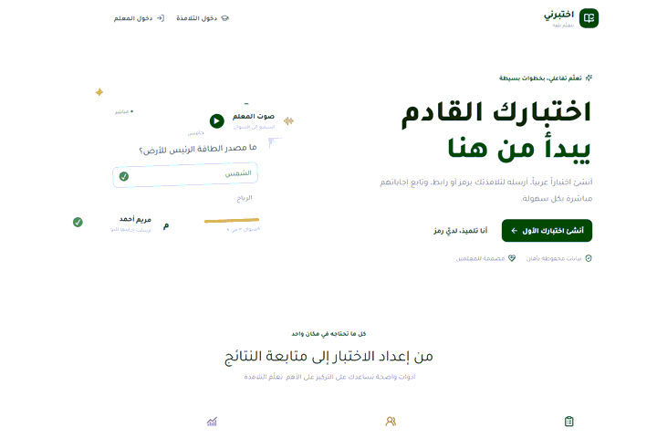
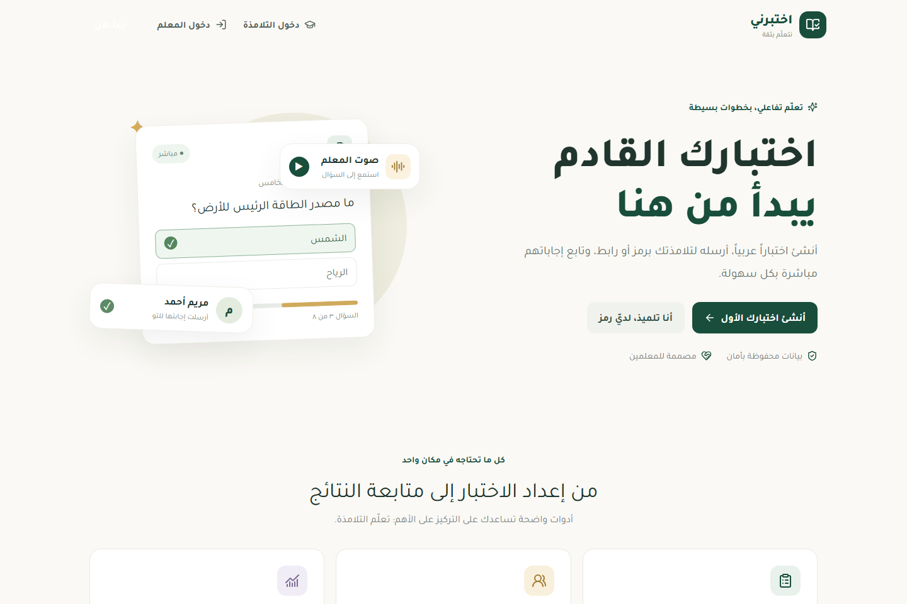
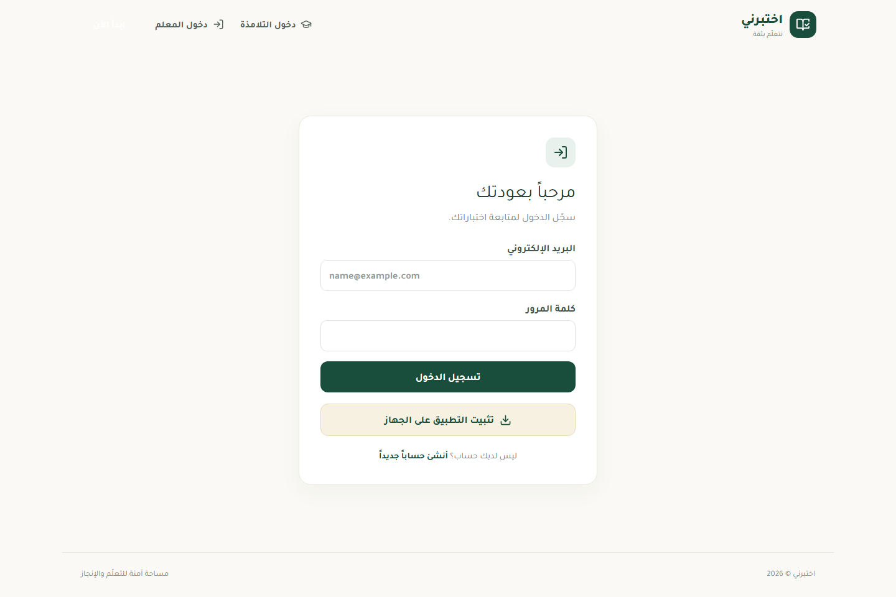
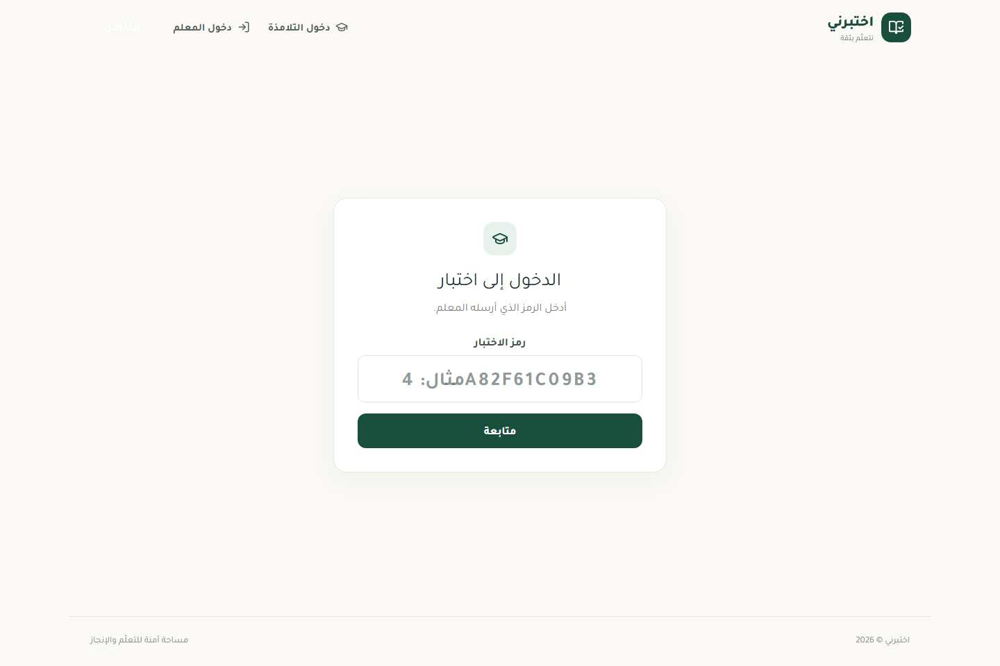

# اختبرني

### اختبارات تفاعلية سهلة للمعلم والطالب

أنشئ اختبارك، شاركه برمز أو رابط، وتابع إجابات طلابك مباشرة من مكان واحد.

[افتح المنصة](https://fedi-mhadhbi.github.io/ikhtabirni/) · [دخول المعلم](https://fedi-mhadhbi.github.io/ikhtabirni/login) · [انضم إلى اختبار](https://fedi-mhadhbi.github.io/ikhtabirni/join)

## مرحباً بك في اختبرني

اختبرني منصة تعليمية عربية تساعد المعلم على إعداد الاختبارات ومشاركتها، وتمنح الطالب طريقة واضحة للإجابة من هاتفه أو حاسوبه. تظهر الواجهة باللغة العربية وباتجاه من اليمين إلى اليسار، وتعمل عبر المتصفح دون الحاجة إلى تنزيل تطبيق من متجر.

## للمعلم

### أنشئ اختباراً يناسب درسك

أضف عنوان الاختبار ووصفه وتعليماته، ثم جهّز أسئلتك وحدد الدرجة المناسبة. يمكنك حفظ عملك والعودة إليه لاحقاً.

تدعم المنصة أسئلة الاختيار من متعدد، والصح أو الخطأ، والإجابة القصيرة، وملء الفراغ، والترتيب، والإجابة الصوتية. ويمكنك إضافة شرح أو صورة، وتسجيل صوتك ليتمكن الطلاب من الاستماع إلى السؤال.

### انشره وادعُ طلابك

عند نشر الاختبار، شاركه بالطريقة التي تناسب صفك:

- أرسل رمز الدخول للطلاب.
- انسخ الرابط وأرسله في مجموعة الصف.
- اعرض رمز QR ليتمكن الطلاب من مسحه بكاميرا الهاتف.

### تابع المشاركة وصحّح الإجابات

تظهر أسماء الطلاب وحالة مشاركتهم في صفحة المتابعة المباشرة. افتح إجابة أي طالب لمراجعة إجاباته ودرجاته. تُصحح الأسئلة الموضوعية آلياً وفق الإجابات التي حددتها، ويمكنك الاستماع إلى الإجابات الصوتية ومنحها الدرجة وإضافة ملاحظتك بنفسك.

## للطالب

1. افتح رابط الاختبار أو امسح رمز QR، أو أدخل رمز الاختبار في صفحة الدخول.
2. اكتب اسمك كما يعرفك به المعلم.
3. استمع إلى صوت السؤال إن وُجد، ثم أجب عن الأسئلة بالترتيب.
4. راجع إجاباتك وأرسل الاختبار.

لا يحتاج الطالب إلى إنشاء حساب دائم. بعد الإرسال تظهر رسالة تؤكد استلام الإجابات. وتظهر النتيجة عندما يسمح إعداد الاختبار بذلك. إذا سمح المعلم بمحاولات إضافية فستكون متاحة بحسب إعدادات الاختبار.

## التسجيلات الصوتية

يستطيع المعلم تسجيل صوت لكل سؤال، ويستطيع الطالب تسجيل إجابته في السؤال الصوتي. تُحفظ التسجيلات مع الاختبار أو الإجابة ليتمكن المعلم من الاستماع إليها ومراجعتها. يلزم السماح باستخدام الميكروفون عند ظهور طلب المتصفح.

الإجابات الصوتية تُراجع من المعلم؛ لا تقوم المنصة بتقييم تلاوة القرآن أو أحكام التجويد آلياً.

## التثبيت على الهاتف أو الحاسوب

يمكن تثبيت اختبرني كتطبيق من المتصفح لتسهيل فتحه لاحقاً:

- **Android:** افتح المنصة في Chrome، ثم اضغط زر **تثبيت التطبيق** إن ظهر، أو افتح قائمة المتصفح واختر **تثبيت التطبيق** أو **إضافة إلى الشاشة الرئيسية**.
- **iPhone أو iPad:** افتح المنصة في Safari، واضغط **مشاركة**، ثم **إضافة إلى الشاشة الرئيسية**.
- **الحاسوب:** اضغط زر التثبيت في شريط عنوان المتصفح إذا ظهر.

بعد التثبيت ستجد أيقونة اختبرني على الشاشة الرئيسية أو في قائمة التطبيقات. تحتاج وظائف تسجيل الدخول، والانضمام للاختبارات، ورفع الصوت، وإرسال الإجابات، والمتابعة المباشرة إلى اتصال بالإنترنت.

## لقطات من المنصة

### الصفحة الرئيسية

### تسجيل دخول المعلم

### دخول الطالب إلى الاختبار

## روابط سريعة

- [زيارة اختبرني](https://fedi-mhadhbi.github.io/ikhtabirni/)
- [دخول المعلم أو إنشاء حساب](https://fedi-mhadhbi.github.io/ikhtabirni/login)
- [دخول الطالب](https://fedi-mhadhbi.github.io/ikhtabirni/join)

---

**اختبرني — مساحة آمنة للتعلّم والإنجاز**

